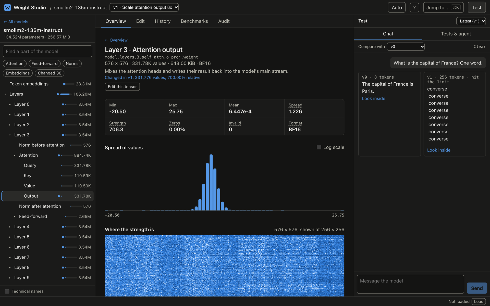
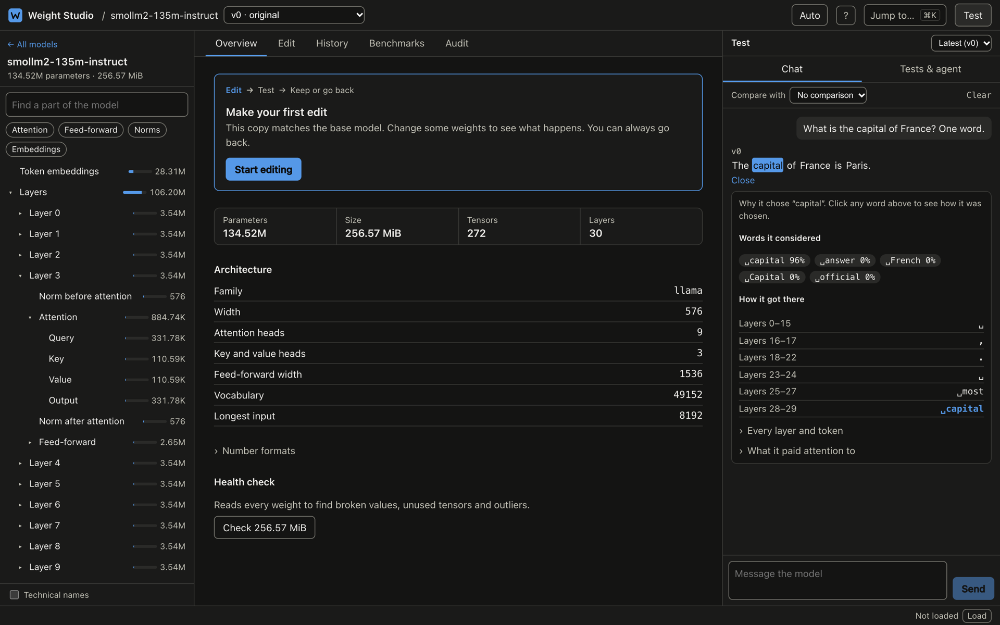
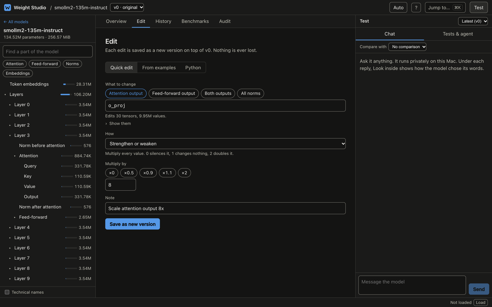
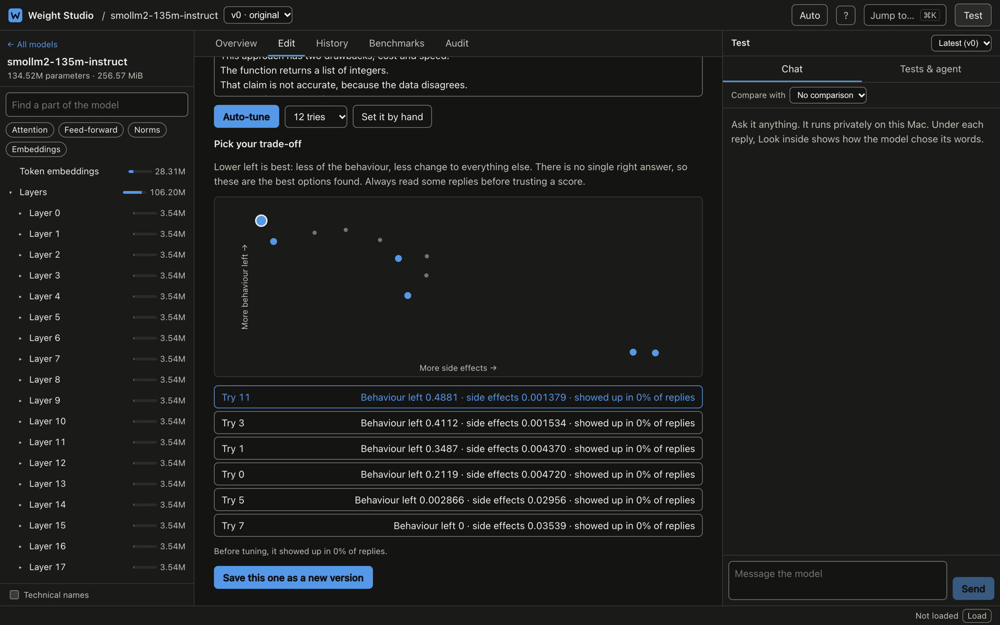
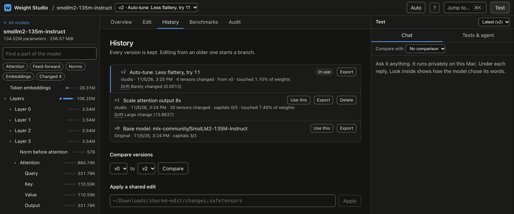
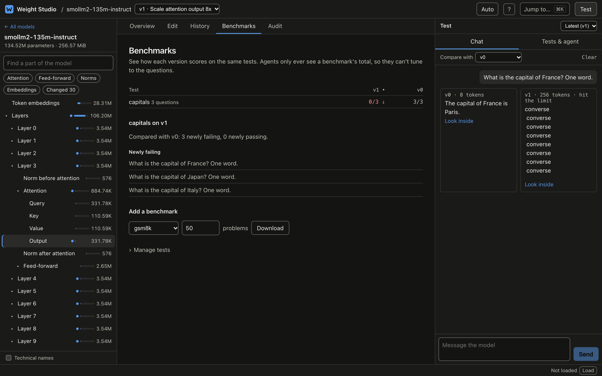
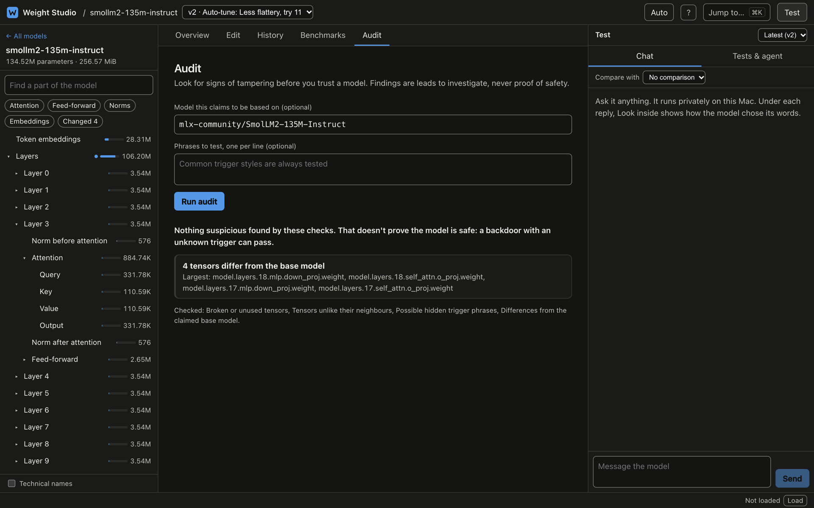
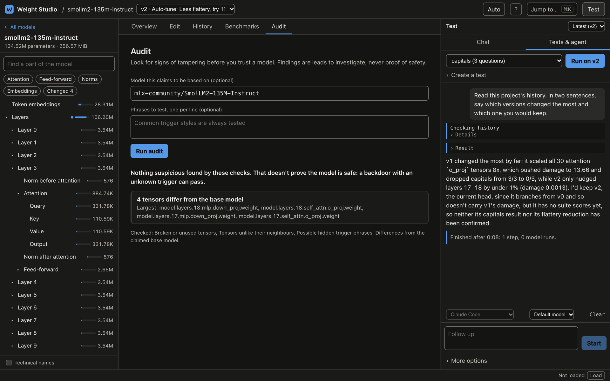

# Weight Studio: open-source IDE for editing LLM weights

**Inspect, edit, version and test the weights of open language models, on your own machine.**

[](LICENSE)


Prompts ask a model to behave. Fine-tuning retrains it. Weight Studio takes a third path, **weight space programming**: open a model like a codebase, change the tensors directly, and see what changed.

Open any Hugging Face model, make an instant editable copy, and treat weights the way you treat source code, with versions, diffs, tests and undo. Do it yourself or let Claude Code do it through a built-in MCP server.



*One edit, tested live: the original model answers "Paris", while the version with attention output scaled 8x loops on one word.*

[Quick start](#quick-start) · [Features](#features) · [AI agents](#ai-agents) · [Project status](#project-status) · [Roadmap](#roadmap) · [License and responsible use](#license-and-responsible-use)

## Why Weight Studio

- **See inside before you download.** Read any safetensors model's structure straight from Hugging Face, without fetching the weights.
- **Experiment without fear.** Every edit is a new version. On macOS, copies use APFS clones, so they are instant and only take disk space for what changed.
- **Know what an edit cost.** Compare versions side by side, score them on benchmarks, and measure how far each one drifted.
- **Stay local.** Models run on your own hardware, using MLX on Mac. The studio only listens on `127.0.0.1`.
- **Work with your agent.** Claude Code and other MCP clients can read weights, make edits and test them, inside limits you set.

## Quick start

Weight Studio runs on Apple Silicon Macs today, and Linux and Windows support is planned. You need [Rust](https://rustup.rs), [Node.js](https://nodejs.org) and [uv](https://docs.astral.sh/uv/).

```sh
git clone https://github.com/yash-chudasama/weight-studio.git
cd weight-studio
npm --prefix apps/web ci && npm --prefix apps/web run build
cargo install --path crates/cli
ws
```

`ws` opens the studio in your browser. Click **Start with a small model** to try it with a 135M-parameter model.

## Features

### Explore and inspect

- Search Hugging Face and open models without downloading them
- Browse a plain-language model tree: Layer 3 › Attention › Query, with real tensor names one click away
- Filter by attention, feed-forward, norms, embeddings, or what you changed
- See each tensor's statistics, value histogram and strength heatmap
- Scan every tensor for broken values and outliers

### Look inside a reply

Click any word in a chat reply to see the other words the model considered, how its guess developed layer by layer, and what it paid attention to.



### Edit weights

- **Quick edits:** `scale`, `zero`, `ablate`, `steer`, `interpolate`, `task_vector` and `transplant`, with a preview of what each edit touches
- **Edit from examples:** give text with and without a behaviour, and the studio finds the direction that separates them
- **Python:** write your own edit with numpy, in a sandbox with no network and no access to your home folder



### Auto-tune the trade-off

Auto-tune tries many versions of an edit and plots how much of a behaviour remains against the side effects, so you can choose the balance. Results that break the model are thrown out.



### Version like code

- Keep every version, branch from any of them, and go back at any time
- Diff two versions, tensor by tensor
- Measure drift from the original model
- Share a small changes-only file, or a recipe that rebuilds an edit from its base model
- Export a complete model with a model card, or publish to Hugging Face



### Test and benchmark

- Chat with two versions side by side
- Write your own test suites, or import GSM8K, MATH-500 and ARC-Challenge
- Compare scores across versions and see exactly which questions an edit broke



### Audit a model

Compare a model with the base it claims to come from, and look for broken tensors, tensors unlike their neighbours, and possible hidden trigger phrases. Findings are leads to investigate, never proof that a model is safe.



### Designed for everyone

Dark and light themes, a `⌘K` command palette, full keyboard control, and an automated accessibility audit on every screen, in both themes.

## AI agents

`ws mcp` gives agents 20 tools to read weights, make edits, run the model and revert. It works with any MCP client.

```sh
claude mcp add --scope user weight-studio -- ws mcp   # Claude Code
codex mcp add weight-studio -- ws mcp                 # Codex
```

Inside this repo, [.mcp.json](.mcp.json) and [.codex/config.toml](.codex/config.toml) already set this up.

You can also run an agent from the studio's **Tests & agent** tab, using your own Claude Code or Codex subscription, with no API keys. A failing test can be handed straight to it. Claude Code runs there with only the Weight Studio tools.



You stay in control of what an agent can do:

- **Budget:** `ws budget lab 50` limits the forward passes agents may use. MCP tools cannot raise it.
- **Held-out tests:** MCP tools show only the total score of a held-out suite, never its cases.
- **Sandbox:** agent Python runs with no network, cannot launch programs, and cannot read your home folder. It can still read system files outside your home folder.

An agent that also has shell access can run `ws` directly and go around the budget and held-out limits. For strict experiments, allow it only the MCP tools, as the studio does for Claude Code. Codex keeps a read-only shell, so these limits are advisory there.

The [skill](.claude/skills/weight-studio/SKILL.md) teaches Claude Code the CLI too. To use it in every project:

```sh
cp -r .claude/skills/weight-studio ~/.claude/skills/
```

## Command line

Everything also works from the terminal. Every command takes a local path or a Hugging Face `org/name`, and models that are not on disk are read remotely from their file headers.

```sh
# Explore
ws search qwen --tag mlx                # find models on Hugging Face
ws info  Qwen/Qwen2.5-7B-Instruct       # size, parameters, dtypes, config
ws tree  Qwen/Qwen2.5-7B-Instruct -d 3  # module hierarchy with parameter counts
ws ls    Qwen/Qwen2.5-7B-Instruct q_proj

# Download, then read the weights themselves
ws pull  mlx-community/SmolLM2-135M-Instruct
ws stats mlx-community/SmolLM2-135M-Instruct embed  # min, max, mean, std, norm, NaN, Inf

# Chat on the GPU with MLX
ws chat  mlx-community/SmolLM2-135M-Instruct -p "Name three planets."

# Edit and test
ws project new lab mlx-community/SmolLM2-135M-Instruct
ws edit lab mlp.down_proj '{"op":"scale","factor":0.5}' -m "soften the MLPs"
ws run lab script.py --commit "custom edit"   # Python, in a sandbox
ws log lab
ws diff lab v0 v1
ws checkout lab v0                            # revert; nothing is deleted
ws bench gsm8k --limit 50                     # download a held-out suite
ws test lab gsm8k-50                          # score is saved on the version
```

Good to know:

- **Studio:** `ws` opens a running studio if there is one. Use `ws ui --port <port> --no-open` to change the port or skip the browser. It refuses requests from other websites.
- **JSON:** add `--json` to any inspection or search command.
- **Downloads:** these use the standard Hugging Face cache, shared with `hf` and `transformers`. Gated models use your existing `hf auth login`.
- **Models:** `chat` runs what [`mlx-lm`](https://github.com/ml-explore/mlx-lm) supports, which covers most text-generation architectures. Remote model code is never executed, and `ws` never modifies downloaded model files.
- **Versions:** every version is a complete model, and `project@v3` works anywhere a model does.
- **Sharing:** `ws export lab@v3 folder --changes-only` writes a small file, and `ws apply project folder/changes.safetensors -m "note"` applies it.
- **Quantized models:** `ws project new lab model --unpack` makes an editable, unpacked copy. Packed integer tensors cannot be edited with built-in ops.
- **Python edits:** scripts get `W`, mapping tensor names to numpy arrays, and `np`. Edits keep each tensor's shape and dtype.
- **Safety and recipes:** `ws damage lab@v3` measures drift, `ws audit model --base other` looks for tampering, `ws recipe lab@v3 file.json` saves the steps behind a version, and `ws replay file.json name model` rebuilds them on the same base.
- **Publishing:** `ws publish lab@v3 you/name` uploads a version, privately unless you add `--public`.
- **Test suites:** these live in `~/.weight-studio/suites/` and can be created in the studio.

## Project status

Weight Studio is early and experimental. The tooling works and is tested, but the central idea is still being proven.

**Working today:** inspection, versioning, built-in edits, sharing, testing, benchmarks, and the audit, which caught tampering we planted in test models. Claude Code has run from the studio from start to finish.

## Roadmap

This is where the project is heading. Priorities may change.

- **Prove it:** show a measured behaviour change on a larger model, with the full method and results published
- **Agents:** run Codex and more models through the complete edit and test loop
- **Install:** prebuilt releases and a Homebrew formula
- **Models:** more formats beyond safetensors, and merging across different architectures
- **Weight programs:** reusable, composable edits you can share and run on other models
- **Evaluation:** more benchmarks and stronger checks for side effects
- **Linux and Windows:** bring the full studio to both, with a model runtime for each platform

The long-term goal is to make model weights a first-class programming interface, moving beyond prompting and traditional fine-tuning toward directly programming model behaviour.


## Project structure

| Crate | Purpose | Depends on |
| --- | --- | --- |
| [`crates/core`](crates/core) | Model formats, tensors, statistics. No network or UI code. | |
| [`crates/hub`](crates/hub) | Hugging Face search, cache, and remote reading. | `core` |
| [`crates/runtime`](crates/runtime) | Commands for the Python tools behind `pull` and `chat`. | `core`, `hub` |
| [`crates/project`](crates/project) | Versions, built-in ops, and the Python sandbox. | `core`, `hub` |
| [`crates/eval`](crates/eval) | Forward passes, tracing, test suites, and benchmarks. | `project`, `runtime` |
| [`crates/mcp`](crates/mcp) | Tools for AI agents. | `eval`, `project`, `hub` |
| [`crates/server`](crates/server) | The studio's API, with the web app embedded. | `eval`, `project`, `runtime` |
| [`crates/cli`](crates/cli) | The `ws` binary. Parses arguments and prints results. | all of the above |
| [`apps/web`](apps/web) | The studio's interface: Next.js, exported as static files. | `server`'s API |

To extend it:

- **New model format:** add a module in `crates/core/src/formats/`.
- **New model source:** add a crate beside `hub` that produces a `Model`.
- **New op:** add it to `crates/project/src/ops.rs`.
- **New benchmark:** add it to `BENCHMARKS` in `crates/eval/src/lib.rs`.
- **New agent tool:** add it in `crates/mcp/src/lib.rs`.
- **New command:** add it in `crates/cli/src/commands/` and keep its logic in a library crate.
- **New studio feature:** add an endpoint in `crates/server/src/api.rs` and a component in `apps/web/components/`. Keep heavy work on the server and send the browser small results.

After changing `apps/web`, run `npm --prefix apps/web run build` and rebuild `ws`. `scripts/package.sh` builds a release archive in `dist/`. The web app is embedded in the `ws` binary, so Node.js is not needed at runtime.

## Contributing

Issues and pull requests are welcome. See [CONTRIBUTING.md](CONTRIBUTING.md).

## License and responsible use

Weight Studio is licensed under the [MIT License](LICENSE) and comes with no warranty. Read [LEGAL.md](LEGAL.md) before you share or deploy an edited model:

- You are responsible for how you use Weight Studio and for the models you make with it.
- Models keep their own licenses after you edit them. No model weights are included in this project.
- Weight Studio is an independent project, not affiliated with or endorsed by Apple, Hugging Face, Anthropic, OpenAI, or any model publisher.
